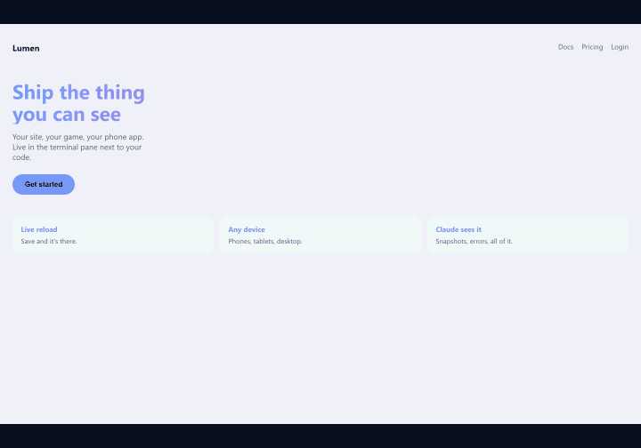

# livepeek

A live viewing portal in your terminal. A Claude Code plugin.

Whatever you're building (a website, a game, a phone app, a document, a
mockup), livepeek renders it live in a split pane next to your work. Edit a
file, save, watch it change. Click, scroll and type go through to the page.

And Claude can look too: after it changes something, it snapshots the pane and
checks the result instead of asking you.

No browser window. No emulator. Nothing to alt-tab to.


*A phone app in Windows Terminal: your shell on the left, the app in an iPhone frame on the right. Save a file and it updates.*



```
/livepeek:livepeek
```

That's the whole interface. It works out what your project is, starts the dev
server if it isn't running, detects your terminal, and splits it.

Run it again from a different project and the **same pane** switches to it,
website, game, phone app. One pane that follows what you're working on, not a
new one each time. Each terminal gets its own: a second Claude session in
another tab opens a pane of its own instead of taking over yours. (Hosts that
give no pane id, such as the VS Code terminal, share one unless you set
`LIVEPEEK_SLOT`.) Press `p` inside the pane to switch without leaving it.

**New here?** [GETTING-STARTED.md](GETTING-STARTED.md) walks through the first
run and the handful of things that can go wrong.

## Before you start

Four things need to be on the machine. livepeek itself downloads nothing, ever.

- **Node.js** 18 or newer. If Claude Code runs, you have it.
- **Chrome or Edge.** livepeek drives the browser you already have instead of downloading one. Windows ships with Edge, so Windows users are covered out of the box.
- **A terminal that can split and draw graphics**, for the full experience: Windows Terminal 1.22+ (the Windows 11 default), or tmux, Zellij, Kitty or WezTerm on macOS and Linux. Anything else still works with less: `--here` runs in the current pane when the terminal can't split, and terminals that can't draw images get the page as text.
- **The browser driver**, one npm package, installed once by you:

  ```
  npm add --global playwright-core@1.63.0
  ```

  livepeek finds it from the global install, from the project's own `node_modules`, or from a full `playwright` install. `livepeek --doctor` tells you if it is missing. Set `LIVEPEEK_BROWSER` to an explicit browser executable when needed; the legacy `PEEK_BROWSER` name remains a compatibility fallback.

If you point livepeek at a Vite, Next or Expo project, that project's dependencies must already be in place.

## Install

```
/plugin marketplace add eddyficial/livepeek-plugin
/plugin install livepeek@livepeek
```

Nothing to add to your project. livepeek drives the Chrome or Edge already on
your machine, headless, through the `playwright-core` driver you installed
once (see Before you start). If a project has full `playwright` with a
downloaded Chromium, that is used instead.

## Open it from any shell

Inside Claude Code, `/livepeek:livepeek` is one way in. The Bash tool can also
run `livepeek` directly while the plugin is enabled because the plugin's
top-level `bin/` is on its PATH.

For PowerShell, cmd, or shells outside Claude Code, copy a wrapper from the
installed plugin cache into a folder on your PATH. With the default Claude
configuration, the v0.7.3 wrappers are here:

```
~/.claude/plugins/cache/livepeek/livepeek/0.7.3/bin/
```

These examples use `$HOME\bin` on Windows and `~/.local/bin` on macOS and
Linux. Add that folder to your PATH if it is not already there.

Windows PowerShell:

```powershell
New-Item -ItemType Directory -Force "$HOME\bin" | Out-Null
Copy-Item "$HOME\.claude\plugins\cache\livepeek\livepeek\0.7.3\bin\livepeek.cmd" "$HOME\bin\livepeek.cmd"
```

macOS or Linux:

```bash
mkdir -p ~/.local/bin
cp ~/.claude/plugins/cache/livepeek/livepeek/0.7.3/bin/livepeek ~/.local/bin/livepeek
chmod +x ~/.local/bin/livepeek
```

If `CLAUDE_CONFIG_DIR` is set, use it instead of `~/.claude`. Each wrapper
looks up the newest installed plugin when it runs, so a copy from any installed
version keeps working after updates.

Then, from any project folder:

```
livepeek              open the pane here, or switch the open one to this folder
livepeek --quit       close it
livepeek --file x.md  show one file
```

Every option in [Options](#options) works the same way.

## What it understands

| you're building | detected from | opens on |
|---|---|---|
| a website | Next, Nuxt, SvelteKit, Astro, Remix, Gatsby, Docusaurus, Angular, CRA, Vite, Parcel, webpack | `fit`: the pane's own size, no bezel |
| a game | any of the above **plus** Phaser, three, Pixi, Babylon, Excalibur, Kaplay, p5 or PlayCanvas | `game-720p`: 16:9, no bezel |
| a phone app | Expo (React Native through its web build) | `iphone-15-pro`, with a phone body |
| a document or mockup | a folder with `index.html`, any `.html`, or a `.md` file (no package.json needed) | `fit` |
| something else | nothing detected | give it `--url http://localhost:1234` or `--file path` |

`fit` renders at the pane's own pixel size, so text is never scaled down; a
fixed size such as `desktop` (1440×900) or `document` (900×1200) is one
`--preset` away.

Phones get a drawn phone body, bezel and camera cutout, with a status bar above
the page the way a real phone has one, so the cutout never covers your header.
The viewport stays its true size. Web, game and document
viewports are drawn bare, because a browser viewport or a game canvas *is* the
thing you're building: a phone frame around it would be a lie.

Markdown is rendered as a page with live reload, served by livepeek itself;
no dependency, no dev server. Plain HTML gets the same reloader injected.

34 presets ship with it: 20 real devices, 7 web sizes (including `fit`, which
fills the pane), 5 game aspect ratios, 2 document pages. `node scripts/tui.mjs --list` prints the ids, and adding one is a
single line in `scripts/presets.js`.

## How it looks

Real pixels wherever the terminal can draw them. The renderer is probed at
startup, never assumed:

| renderer | terminals | notes |
|---|---|---|
| kitty graphics | Kitty, Ghostty, WezTerm | 24-bit colour, zlib-compressed frames |
| sixel | Windows Terminal 1.22+, xterm, foot, mlterm | up to 256 colours |
| text | terminals that can't draw images (the automatic fallback) | the page laid out as readable text; see Terminals |
| half-blocks | anything with truecolor | coarse picture; pick it with `b` |

The footer names the active renderer when the pane is wide enough. Press `b`
to cycle if the probe got it wrong.

## Supported platforms

What livepeek needs: Node 18 or newer and Chrome or Edge installed. A terminal
that can split opens the pane for you; anywhere else, `--here` runs it in the
current pane. Whether you get a picture or text depends on the terminal.
"Verified" means driven by hand on that setup for the current release;
"expected" means the code path is the same but nobody has run it there yet.

| terminal | OS | you get | status |
|---|---|---|---|
| Windows Terminal 1.22+ | Windows | picture (sixel) | verified |
| VS Code terminal, `terminal.integrated.enableImages` on | Windows | picture (sixel or kitty) | verified |
| VS Code terminal, setting off | any | text | verified on Windows |
| Zellij | Windows | text only. Zellij on Windows draws no images | verified |
| Zellij | macOS, Linux | picture (sixel) | expected |
| tmux 3.4+ with `allow-passthrough on` | macOS, Linux, Windows | picture | expected |
| Kitty, Ghostty | macOS, Linux | picture (kitty graphics) | expected |
| WezTerm | macOS, Linux, Windows | picture (sixel) | expected |
| macOS Terminal.app, plain PowerShell or cmd window | | no split and no graphics: use `--here` inside tmux, or get text | expected |

In VS Code the terminal has to be split by hand; see below. Every row above
also gets live reload, mouse clicks, scrolling, typing and `--snapshot`, which
always captures the real page at full resolution whatever the terminal shows.

The automated test suite (image encoders, static server, markdown and text
renderers, launcher detection, a headless browser round trip) runs on Windows
and Ubuntu in GitHub Actions on every push. `livepeek --doctor` tells you which
row you are in before you open a pane.

## Terminals

The pane is created by whichever multiplexer is hosting you:

| host | detected via |
|---|---|
| tmux | the `TMUX` variable |
| Zellij | the `ZELLIJ` variable |
| Kitty | the `KITTY_LISTEN_ON` variable |
| WezTerm | the `WEZTERM_PANE` variable |
| Windows Terminal | the `WT_SESSION` variable |

tmux works on macOS, Linux and Windows, so it's the universal fallback: start
`tmux` and you have a pane anywhere. With no multiplexer at all, `--here` runs
the view in your current pane instead.

Under tmux, graphics need passthrough enabled:

```
set -g allow-passthrough on
```

**VS Code's terminal works, with one manual step.** Nothing outside VS Code can split its terminal, so: split it yourself (the split icon, or Ctrl+Shift+5 / Cmd+\ on a Mac), and in the new half run `livepeek --here`. Live reload, clicks and keys all work. For pictures rather than text, turn on the setting `terminal.integrated.enableImages` and reload the window (Developer: Reload Window); a new terminal alone is not enough. Tested on VS Code 1.140: both sixel and kitty graphics render there. Running `tmux` inside the VS Code terminal also works, and then `/livepeek:livepeek` splits for you.

**No graphics? You get the page as text.** Some hosts cannot draw images at all (Zellij on Windows is one; it passes the terminal's sixel reply through but renders nothing). There livepeek lays the page out as text instead: headings, paragraphs, lists, links and buttons, wrapped to the pane. Scrolling scrolls, clicking a link or button clicks it, `i` types into a focused field. It is a reader, not a picture, so layout and colour are gone, but every word is legible. `b` cycles kitty, sixel, text and half-blocks if the automatic choice is wrong. For a sharp picture on Windows, run livepeek from a Windows Terminal pane directly.

In Windows Terminal the pane is split into the window you used most recently
(`wt -w 0`). With several Windows Terminal windows open, run livepeek from the
one you want it in, or click into that window first.

Each pane belongs to the terminal pane it was launched from (the tab your
Claude session runs in), so two sessions in two tabs each get their own view.
`--snapshot`, `--eval`, `--quit` and `--status` act on that terminal's pane,
or on the only pane open if it has none, such as a `--here` view in a split you
made by hand. tmux, Zellij, Kitty, WezTerm and Windows Terminal give each pane
an id; elsewhere (the VS Code terminal, a plain console) every session shares
one pane. `LIVEPEEK_SLOT` overrides this: give two shells different values to
keep them apart, or the same value to share. An extra pane from `--new` or
`--compare` has a slot of its own: control commands reach it only once it is
the only pane left, so close it with `q`.

## Keys

Focus the pane first: `alt`+arrow in most terminals, `prefix`+arrow in tmux,
or click the picture. If letters you press turn up in Claude's input box
instead, the focus is still on the other pane.

| key | does |
|---|---|
| click / drag / scroll / hover | goes through to the page |
| `i` | **typing mode**: send keystrokes to the page |
| `space` | **pick a device**; start typing to filter: `iph`, `sam`, `pixel`, `desk` |
| `p` | **switch project**: every folder you have previewed before, plus any dev server running |
| `shift`+`?` | help overlay with every key |
| `[` `]` | previous / next device |
| `o` | rotate |
| `r` | reload |
| `e` | **page errors**: the footer shows a red count when the page throws; `e` lists them |
| `d` | dark / light: flips `prefers-color-scheme` so you see both themes |
| `+` `-` `0` | zoom in / out / reset |
| `c` | copy the frame to the clipboard as an image |
| `w` | open the page in your own browser, full size (or click the address in the header) |
| `g` | go to a page: type `/settings` (or `localhost:3000`) and press enter |
| `x` | point at something: hover outlines it, a click picks it for Claude and copies a reference to paste |
| `m` | QR code: scan it to open the page on your phone (same Wi-Fi) |
| `.` | pause refreshing |
| `b` | cycle renderer: kitty, sixel, text, half-blocks |
| `q` | quit and close the pane |

Anything with alt or ctrl held is left alone, so your terminal's own bindings
still work; alt+arrow moves between panes rather than reaching the viewer.

Quit with `q` rather than killing it; that shuts the headless browser down
cleanly instead of orphaning it.

### Picking a device

`space` opens the device picker: every screen livepeek can show, from phones
and tablets to laptop and desktop sizes and game shapes. The current one is
ticked.

**Type to narrow it down.** Each letter filters the list, and the search line
shows what you have typed:

| type | leaves |
|---|---|
| `iph` | iPhones |
| `sam` | Samsung Galaxy phones |
| `pixel` | Google Pixels |
| `ipad` | iPads |
| `desk` | desktop sizes |
| `game` | game aspect ratios |

The filter matches anywhere in the brand, the model, the OS and the preset id,
so `ios` finds every Apple device, `android` every Android one, and `ultra`
the S24 Ultra. Once you have started typing, a space is part of the search
(`iphone 15`); on an empty filter, `space` closes the picker again.
`backspace` takes the last letter off; if nothing matches, the picker says so.

Then `↑`/`↓` move, `PageUp`/`PageDown` jump, `Home`/`End` go to the ends,
`enter` selects, `esc` closes without changing anything. The mouse wheel
scrolls the list and a click picks. The page resizes to the new device at once.

The right-hand column is each device's viewport in CSS pixels (`384x824`).
**Fit to pane** says `pane size`: it fills whatever space the pane has and
follows it when you resize the pane.

With kitty or sixel graphics the picker is drawn as a panel with a search
field and a small outline of each device; in text or half-block mode, or a
very short pane, it is a plain list.

Without opening it, `[` and `]` step to the previous or next device in the
list, and `o` turns the current one between portrait and landscape.

### Point, go to, open elsewhere

- **`x`, point at something.** Hovering outlines the element under the pointer
  in pink, with its tag; a click picks it. Claude reads the pick with
  `livepeek --picked` (text, selector, and the React or Vue component that
  drew it), and a one-line reference is copied to your clipboard to paste
  into the chat. `esc`, or any other key, stops pointing.
- **`g`, go to a page.** A line opens in the footer, filled in with the
  current path. Type `/settings`, `localhost:3000` or a full address and press
  `enter`; `esc` cancels. Another server becomes the pane's target, as if you
  had picked it with `p`.
- **`w`, open in your browser.** Opens the page in your normal browser at full
  size. Clicking the address in the header does the same.
- **`m`, open on your phone.** Shows a QR code for the page at your machine's
  network address; scan it with the phone camera on the same Wi-Fi. A dev
  server has to listen on the network for that to work:
  `npm run dev -- --host` for Vite and Astro, `npm run dev -- -H 0.0.0.0` for Next.js; the QR
  screen says which when it can't reach yours. For a folder or file
  livepeek serves itself, press `s` on the QR screen to share it on the
  network. If the phone still can't load it, allow Node.js through your
  firewall. Dot-files (`.env`, `.git`) are never served.

### The welcome card

In picture modes, the first few launches show a welcome card pointing at the device name in the
header; clicking the name opens the picker. The card stops appearing once you
have used the picker, or after three launches.

### Typing

Press `i` and every keystroke goes to the page instead of the viewer: text,
arrows, Enter, Tab, Backspace, Home/End/PageUp/PageDown, Delete, and
ctrl+letter combinations. `esc` stops.

Which necessarily means `q` no longer quits while you're typing: it types a
`q`. The footer turns into a badge saying so, and `ctrl+c` always quits
regardless of mode.

To fill in a form, click the field first: the click focuses it, the same way
it would in a browser, then press `i` and type.

**Games get different treatment, automatically.** A terminal reports
keystrokes, never "still held", so a game sampling input once per frame would
miss almost every press. When the focus isn't a text field, each key is held
down for 90 ms instead, long enough for several frames to see it. WASD moves
properly.

In a text field it types normally, so forms stay responsive. You don't choose
between the two; it checks what has focus.

There's still no true held state: holding `W` gives you your terminal's
key-repeat rather than continuous movement. Charge-up mechanics and
analogue-feeling input will be approximate.

## Options

```
/livepeek:livepeek --preset laptop          a different viewport
/livepeek:livepeek --url http://localhost:1234   skip detection, point at a server
/livepeek:livepeek --port 3000              non-default dev server port
/livepeek:livepeek --size 0.4               wider pane
/livepeek:livepeek --interval 200           refresh faster (default 600 ms, more CPU)
/livepeek:livepeek --render sixel           force a renderer: kitty, sixel or blocks
/livepeek:livepeek --horizontal             split below instead of beside
/livepeek:livepeek --no-serve               a server is already running
/livepeek:livepeek --file docs/spec.md      show one file (markdown or html)
/livepeek:livepeek --snapshot out.png       write what the pane shows to a PNG
/livepeek:livepeek --eval 'innerWidth'      run a snippet in the shown page
/livepeek:livepeek --picked                 the element you last pointed at (x, then click), as JSON
/livepeek:livepeek --here                   run in this pane, don't split
/livepeek:livepeek --new                    force a second pane instead of reusing
/livepeek:livepeek --quit                   close the open pane cleanly
/livepeek:livepeek --compare desktop,iphone-15-pro   two panes side by side, one per preset (--quit closes the first; q closes either)
/livepeek:livepeek --status                 what this terminal's pane shows, as JSON
/livepeek:livepeek --doctor                 check Node, browser, driver, terminal and graphics, say what will work
/livepeek:livepeek --dry-run                print what it would do and stop
```

## Claude can see it

`--snapshot` writes the page the pane is showing to a PNG at full resolution,
and `--eval` runs a snippet in it and prints the result. The bundled skill
tells Claude to use both after it edits something you can see: change, wait a
beat, snapshot, look, then report what's actually on screen. You stop being
the one who has to say "no, it's still wrong".

It works the other way too. Press `x` in the pane and click the thing you
mean, then tell Claude "make this bigger". It reads your pick with
`--picked`: the element's text, a selector, and the React or Vue component
that drew it, so "this" needs no describing.

## Limits

It drives a real browser, so it shows what a browser shows, and only that.

- **Phone apps** render their *web* build. Native-only modules are absent:
  `react-native-maps`, `expo-camera`, native Stripe, background location, push
  notifications. Use a device or emulator for those screens.
- **Games** render on canvas and WebGL, but the frame rate you see is the
  screenshot interval (600 ms by default), not the game's. It's for watching
  layout and state, not judging animation. `--interval 200` gets closer, at
  the cost of CPU.
- **Held keys** are approximated: each press is held 90 ms when focus isn't a
  text field, so WASD works, but there's no continuous held state. See Typing.

## When something is wrong

`livepeek --doctor` (or `/livepeek:livepeek --doctor`) checks everything livepeek needs and says which renderer your terminal will get. Run it first if the pane looks like coloured noise or never opens.

The pane also tells you when the page is unwell: a red `2 errors` in the footer means the page threw or logged `console.error` (press `e` to read them), and `page not responding` means the browser stopped answering, which usually means a tight loop in your code.

## Status line

`livepeek --status` prints one line of JSON about this terminal's pane that any status line or prompt can read: `target` (what is shown), `preset`, `errors` (count on the current page), `host` and `pid`. It exits non-zero when no pane is open. A one-liner for a shell prompt:

```
node -e "try{const s=JSON.parse(require('child_process').execSync('livepeek --status',{stdio:['ignore','pipe','ignore']}));process.stdout.write('livepeek '+s.preset+(s.errors?' !'+s.errors:''))}catch{}"
```

## Tests

`node test/run.mjs` runs the unit, launcher and browser tests. It needs no terminal multiplexer; the browser tests use whatever Chrome or Edge it finds and skip if there is none, or if `playwright-core` cannot be resolved from the repo. The same suite runs on Windows and Linux in GitHub Actions on every push.

## What livepeek runs

Everything livepeek does, so you can check it before installing. It collects and sends nothing; see [PRIVACY.md](PRIVACY.md).

- **Starts a headless Chrome or Edge** that is already installed on your machine, and screenshots it. No browser is downloaded.
- **Downloads nothing.** The browser driver (`playwright-core`, pinned to 1.63.0) is something you install once with npm; livepeek only looks for it and tells you the command if it is missing.
- **Serves your files on localhost.** For a plain folder, `.html` or `.md` file it starts a small web server on a random local port. It does not listen on other network interfaces.
- **Starts your dev server, only if you ask.** Opening a Vite, Next, Expo or similar project runs that project's own `npm run` script, and picking a stopped project in the `p` list does the same.
- **Writes a little local state** to `~/.livepeek/`: which panes are open (`panes/`, one small file per terminal), the folders you have previewed (`projects.json`), and whether the first-run welcome card still needs showing (`intro.json`). On first use, an existing `~/.peek/` is migrated when the new directory does not yet exist. Delete the folder to clear it.
- **Sends nothing anywhere.** No telemetry, no analytics, no account, no outbound requests of its own. The pages you preview make whatever requests they normally would.
- **Has no hooks and no MCP server.** It adds one skill and one optional `livepeek` shell command.
- **Clipboard, only when you press `c`.** Copying a frame uses PowerShell on Windows, `osascript` on macOS, and `wl-copy` or `xclip` on Linux. Nothing is read from the clipboard.

## How it works

A headless Chromium is driven at the preset's CSS viewport, screenshotted on a
loop, composited and painted into the pane as graphics escape sequences.
Terminal mouse reporting is mapped back through the same transform, so a click
in the pane lands at the right page coordinate.

```
scripts/
  pane.mjs        detect terminal + framework, split, hand off to the viewer
  targets.mjs     framework -> port, dev script, default preset
  tui.mjs         the viewer itself; starts the dev server inside the pane
  doctor.mjs      --doctor: checks Node, browser, driver, terminal, graphics
  presets.js      viewports: devices, web breakpoints, game ratios
  welcome/        the page shown when a folder has nothing to preview
  lib/driver.mjs  finds playwright-core (global, project, or full playwright)
  lib/caps.mjs    terminal capability probe, renderer choice
  lib/png.mjs     PNG decoder (zlib + scanline unfilter)
  lib/sixel.mjs   sixel encoder, plus the optional half-block renderer
  lib/kitty.mjs   kitty graphics encoder, tmux passthrough
  lib/phone.mjs   phone body geometry and compositing
  lib/bare.mjs    frameless compositing, for web, games and documents
  lib/serve.mjs   built-in static server, markdown renderer, live reload
  lib/pngenc.mjs  PNG encoder for snapshots
  lib/session.mjs one pane per terminal: reuse, retarget, snapshot, eval
  lib/projects.mjs folders previewed before, for the `p` picker
  lib/state.mjs   the ~/.livepeek directory (and one-time ~/.peek migration)
  lib/textview.mjs text renderer for hosts that cannot draw images
  lib/menuview.mjs the device picker drawn as a picture
  lib/intro.mjs   when to show the first-run welcome card
```

## Licence

MIT
